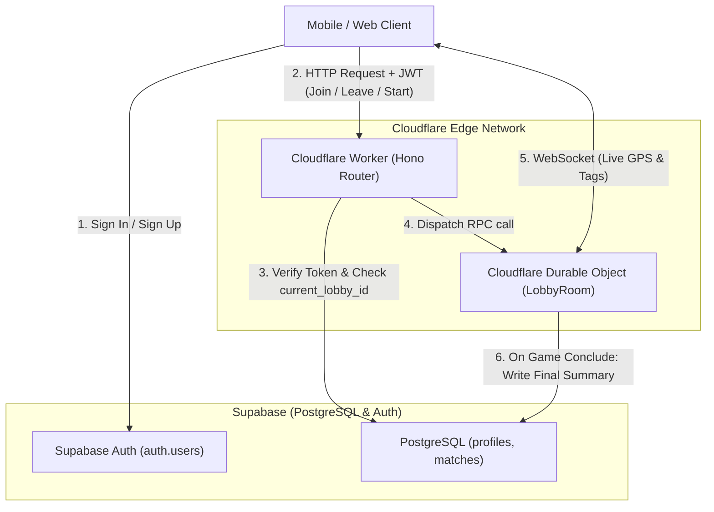
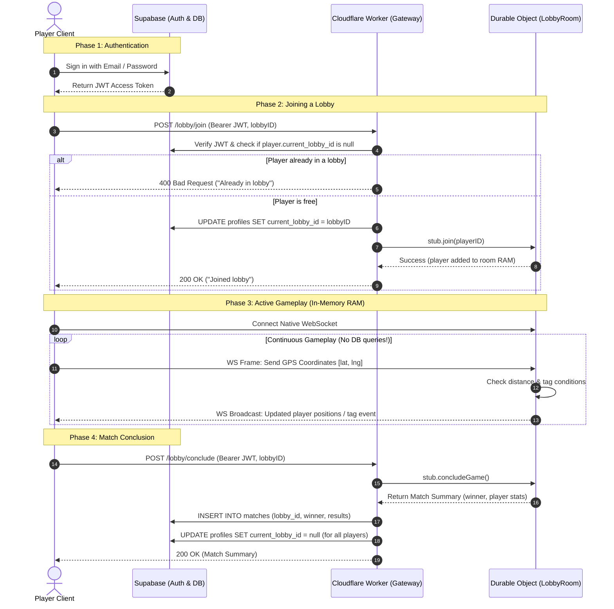

# Tagg Architecture & Data Flow

This document outlines the architecture for **Tagg**, a real-time multiplayer location-based tag game. 

The architecture is designed to be **compute- and cost-efficient**:
- **High-frequency real-time gameplay** (GPS coordinates, live tagging) runs entirely in RAM at the edge.
- **Low-frequency persistent operations** (authentication, lobby transitions, match conclusions) interact with the database.

---

## 1. High-Level System Architecture



---

## 2. Division of Responsibilities

| Responsibility | Handled By | Storage Medium | Why? |
| :--- | :--- | :--- | :--- |
| **Authentication & Credentials** | Supabase Auth | Encrypted Postgres (`auth.users`) | Secure password hashing, OAuth, JWT issuance. |
| **Player Profiles & Stats** | Supabase DB | Postgres Table (`public.profiles`) | Long-term persistence for username, career wins, and overall stats. |
| **Active Lobby Tracking** | Supabase DB | Column (`profiles.current_lobby_id`) | Global single source of truth preventing players from joining multiple lobbies simultaneously. |
| **Match History & Records** | Supabase DB | Postgres Table (`public.matches`) | Permanent record of past games, winners, scores, and timestamps. |
| **HTTP Routing & Auth Guard** | Cloudflare Worker | Stateless V8 isolate | Fast request routing via Hono and JWT validation before touching rooms. |
| **Active Live Game State** | Cloudflare Durable Objects | In-Memory RAM (`LobbyRoom`) | Zero database queries during gameplay. Strong consistency per room. |
| **Live GPS Coordinates** | Cloudflare Durable Objects | In-Memory RAM | Updates every 1–2s. Storing this in a database would cause massive unnecessary write load and latency. |
| **Real-time Broadcasting** | Cloudflare Durable Objects | Native WebSockets | Low-latency broadcast of player movements and tag events to everyone in the room. |

---

## 3. End-to-End Game Lifecycle



---

## 4. Data Schemas

### A. Supabase Database Schema (PostgreSQL)

```sql
-- 1. Profiles Table (Linked to Supabase Auth)
create table public.profiles (
  id uuid references auth.users on delete cascade primary key,
  name text not null,
  current_lobby_id text default null,
  total_games_played int default 0,
  total_wins int default 0,
  created_at timestamp with time zone default timezone('utc'::text, now()) not null
);

-- 2. Matches Table (Game History & Conclusions)
create table public.matches (
  id uuid default gen_random_uuid() primary key,
  lobby_id text not null,
  winner_role text check (winner_role in ('hider', 'hunter')),
  player_results jsonb not null, -- Array of { player_id, name, role, was_tagged }
  concluded_at timestamp with time zone default timezone('utc'::text, now()) not null
);
```

### B. Durable Object In-Memory State (`LobbyRoom`)

When a lobby is created, its creator automatically joins it. The first player to join is the host, so the creator becomes the host. The host is responsible for assigning player roles before the game starts.

```typescript
export class LobbyRoom extends DurableObject<Env> {
    // Ephemeral state alive only during the match
    players: Map<PlayerID, {
        name: string;
        role: "hider" | "hunter" | null;
        coordinates: [latitude: number, longitude: number] | null;
        isTagged: boolean;
    }> = new Map();

    running: boolean = false;
    hostID: PlayerID | null = null;
    startedAt: number | null = null;
}
```

---

## 5. Why this Architecture is Cost & Compute Efficient

1. **Database Write Minimization:**
   A typical 10-minute game with 6 players sending GPS updates every second would generate **3,600 database writes** if stored in Postgres. With Durable Objects, database writes are **exactly 2**:
   - 1 write on join (`current_lobby_id`).
   - 1 write on conclude (`INSERT INTO matches`).
2. **Global Edge Latency:**
   Game actions and WebSocket frames run directly on Cloudflare's edge network, guaranteeing minimal lag for players in the field.
3. **Clean Teardown:**
   Once a match concludes and players disconnect, Cloudflare idles or evicts the Durable Object from RAM automatically, consuming zero ongoing compute resources.
